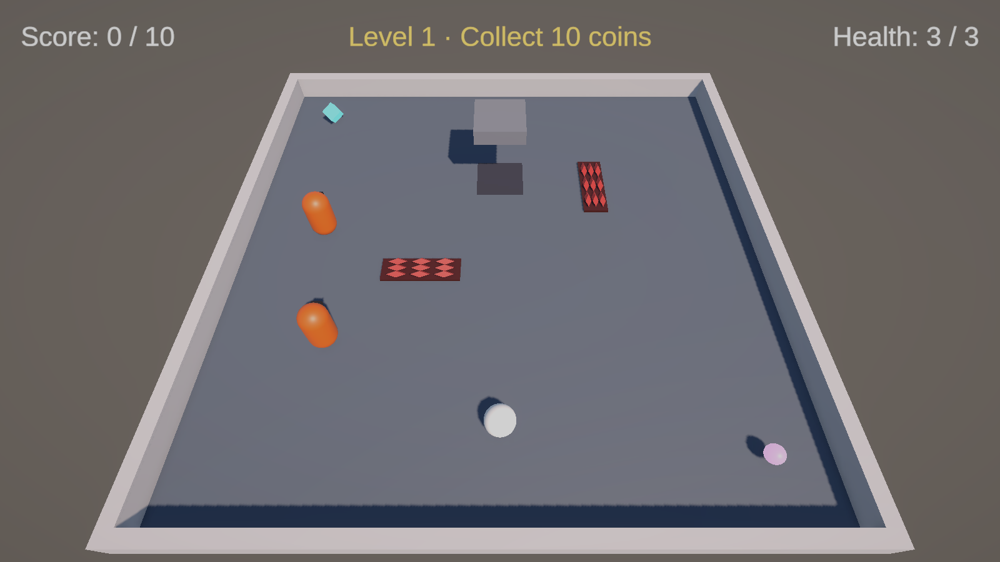
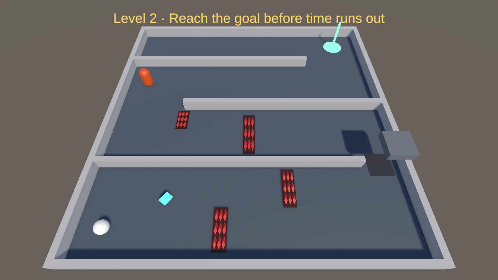
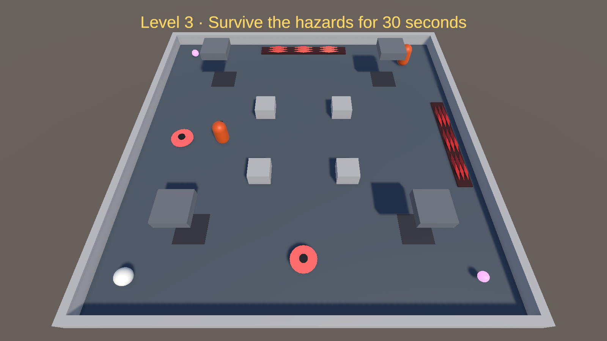
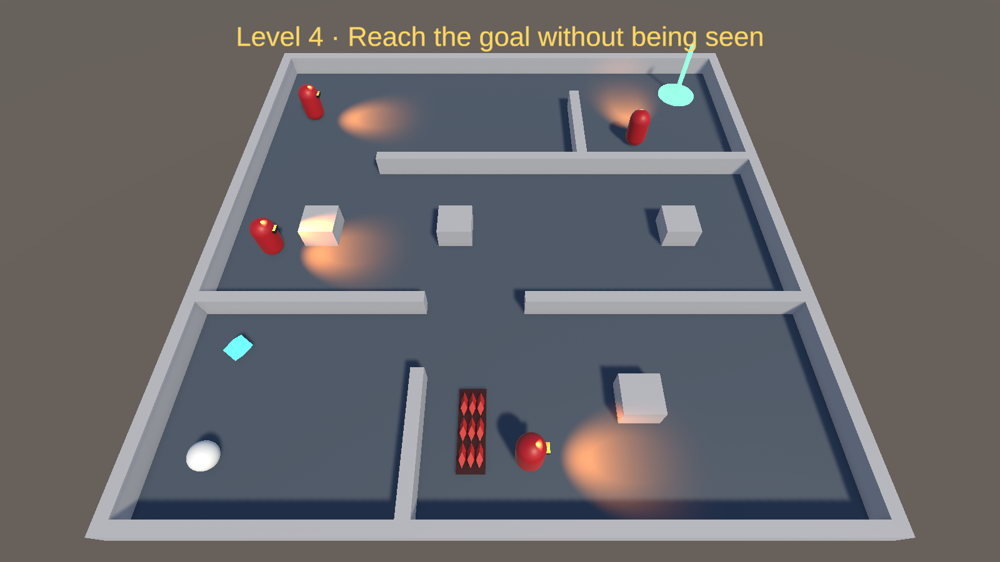
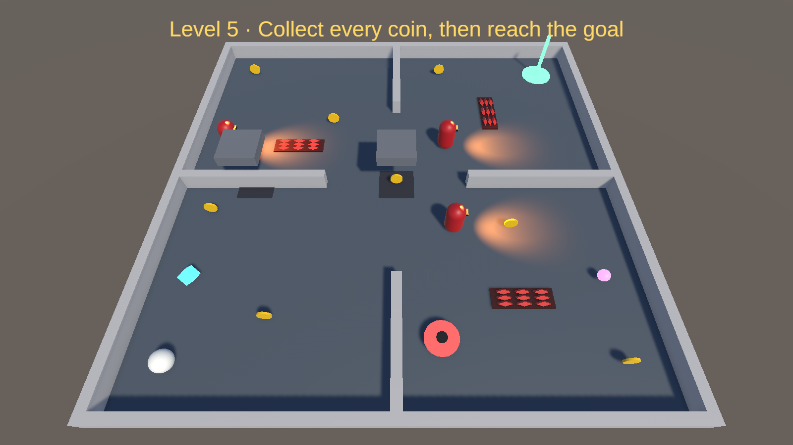

# ITU-CS-464-LAB-06-BSCS23051

**Name:** Muhammad Talha
**Roll number:** BSCS23051
**Course:** CS-464 Game Development, Lab 06

## What this is

For this lab I recreated the arena game from Lecture 07 and then turned it into a 5-level game. Level 1 is the game from class. Levels 2 to 5 each have their own layout and objective, and they get harder as you go.

You play a ball and move it with WASD or the arrow keys. Win a level and the win screen gives you a Next Level button. Lose all your lives and you get a Game Over screen with Restart.

## Part 1: the game from Lecture 07

I started from my Lab 05 arena (Lecture 06) and added the four parts from Lecture 07. The six scripts follow the lecture's code. The only change is that the player reads input through the Input System, because these projects have the old Input class turned off.

- **PlayerController.cs** pushes the ball with `AddForce` in FixedUpdate (move force 10). I set the Rigidbody's Linear Damping to 1.2 like Lecture 06, so the top speed works out to about 8.3 m/s.
- **EnemyPatrol.cs** moves a guard between waypoints with `MoveTowards`. It checks arrival with `==`, which is only safe because MoveTowards lands exactly on the point. It has Loop, PingPong and Random modes, plus a wait time. Each guard has a kinematic Rigidbody (anything that moves gets one), a trigger collider and Hazard.cs, so touching it hurts.
- **Hazard.cs** is one script for the spikes, the guards and the crusher. It damages in `OnTriggerStay` and knocks you back with one Impulse of 6. The crusher uses the coroutine version: it rests with its collider off for 2.4 s, shows an orange warning for 0.7 s, then strikes for 0.4 s and does 2 damage. I added a small visual script (CrusherSlab.cs) so the slab actually drops while it strikes.
- **Health.cs** gives the player 3 hearts with 1 second of i-frames, so OnTriggerStay can't take every heart at once. It dies at `<= 0`, not `== 0`, because a crusher hit of 2 can skip over 0.
- **PowerUp.cs** has two kinds. Speed multiplies the push by 1.6 for 5 seconds, and the timer runs on the player (BoostSpeed), so destroying the pickup doesn't stop it. Shield blocks the next hit.
- **GameManager.cs** owns the score, 3 lives, the respawn, and the win and lose screens. When you die it waits 0.6 s before respawning, so the queued knockback doesn't push the respawned player, and then gives 1.5 s of protection. Restart sets `Time.timeScale` back to 1 before reloading.

## Part 2: five levels

To make the levels I added an objective, a timer and a goal to the GameManager, and a Goal.cs trigger. Each level sets its own objective in the Inspector: Score, ReachGoal, Survive or CoinsThenGoal. Two more scripts came from the lectures: MovingHazard.cs (Lecture 07's moving hazard with `Mathf.PingPong`) and GuardVision.cs (Lecture 05's `CanSee`, using a dot product, a range and a raycast).

| Level | Objective | Layout | What makes it harder |
|---|---|---|---|
| 1 | Collect 10 coins | Open 20 × 20 arena, coins spawn | 2 guards at 2.6 m/s, 2 spike strips, 1 crusher (rest 2.4 s) |
| 2 | Reach the goal in 45 seconds | Zig-zag of three walls | A crusher blocks the 3 m gap you have to pass, so you have to time it (rest 2.0 s). Spike strips on the route, a guard at 3 m/s |
| 3 | Survive for 30 seconds | Open arena with pillars | 4 crushers (rest 1.4 to 2.0 s, warning 0.6 s), 2 saws sliding across the whole arena, 2 guards moving at random at 3 m/s |
| 4 | Reach the goal without being seen | Rooms with walls and cover blocks | 4 guards with a 60° view cone and 6 m range. Being seen costs a whole life. Walls and cover block their view |
| 5 | Collect all 8 coins, then reach the goal in 75 seconds | Four rooms joined in the middle | 3 seeing guards at 3.4 m/s with 7 m range, 2 faster crushers (warning 0.5 s), a saw at 3 m/s, 3 spike strips. One coin sits under a crusher |

Each guard in Levels 4 and 5 carries a spotlight with the same 60° angle as its view, so you can see where it's looking. I kept every crusher warning at 0.5 s or more, because the lecture said a warning shorter than reaction time isn't fair. In Level 5 the goal stays locked until you have all the coins.

## Screenshots

| | |
|---|---|
|  |  |
|  |  |
|  | |

## How to run

Open the project in Unity 6.3 (6000.6.3f1) and open `Assets/Scenes/Level1.unity`. All five levels are in the build list in order, so Next Level takes you from Level 1 through to Level 5.
